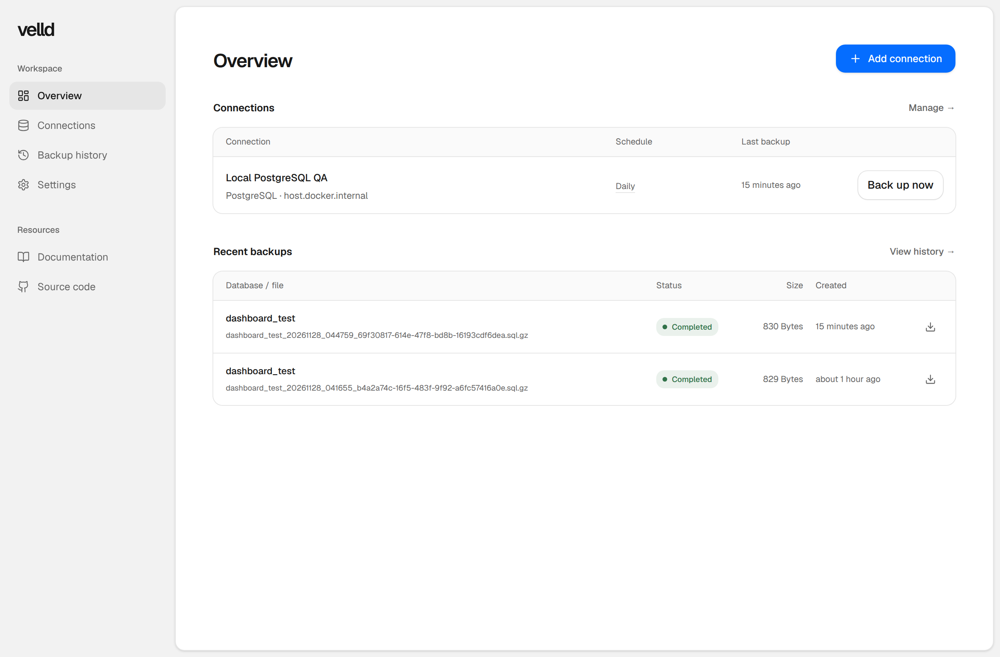
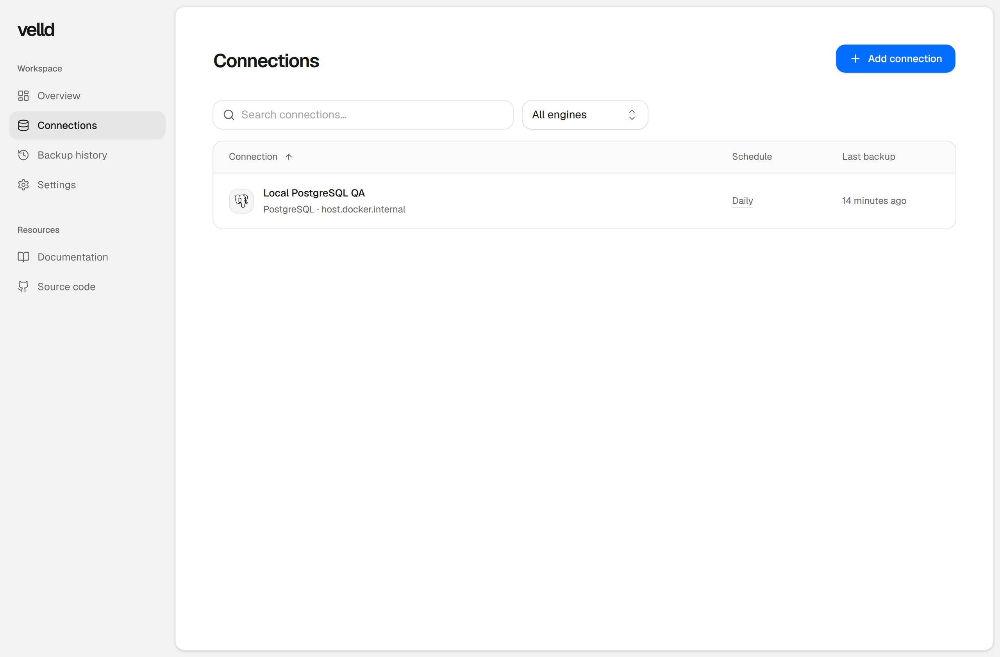
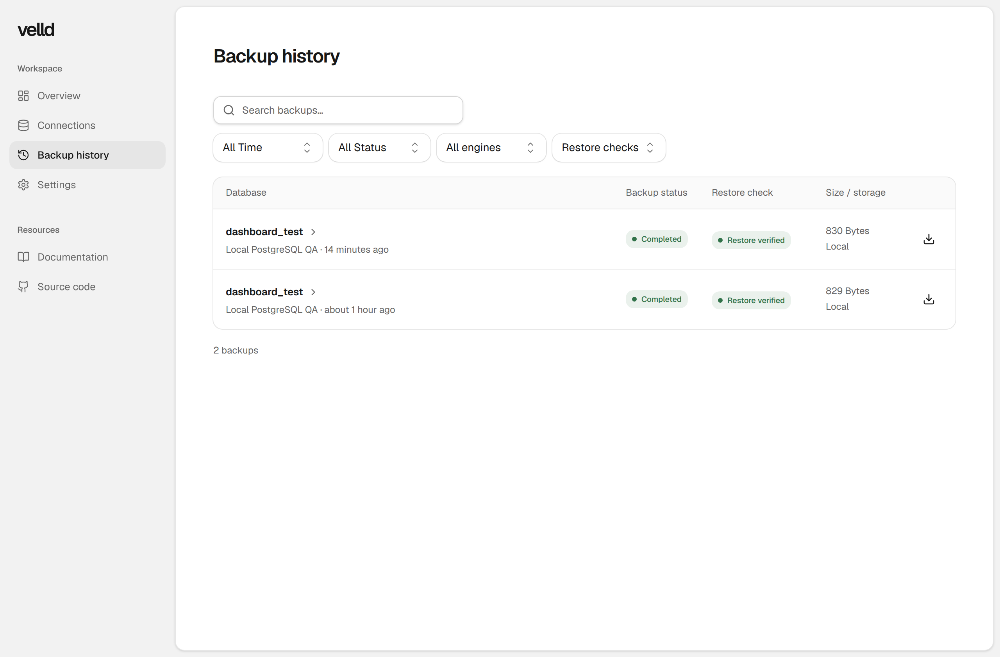

# Velld

Self-hosted backups for PostgreSQL, MySQL, MongoDB, and Cloudflare D1.

[Documentation](https://velld.vercel.app/docs) · [Installation](https://velld.vercel.app/docs/installation) · [Recovery](https://velld.vercel.app/docs/restore-best-practices)

## What it does

| Back up | Recover |
| --- | --- |
| Manual backups and cron schedules | Restore into an empty database |
| Local files, S3-compatible storage, or Cloudflare R2 | Automatic restore checks |
| Multi-database selection, SSH tunnels, Docker discovery | Temporary masked branches and schema comparison |
| Retention policies and failure alerts | PostgreSQL 18 rehearsals, container upgrades, and PITR |

D1 uses Cloudflare's SQL export API and SQLite restore checks. Direct D1 restore, branches, schema comparison, and PITR are not available in the dashboard. Docker is required for the other engines' restore checks and disposable recovery environments.

## Run with Docker

Requires Docker Compose v2, Git, and OpenSSL.

```bash
git clone https://github.com/dendianugerah/velld.git
cd velld
umask 077
cp -n .env.example .env
```

Edit `.env`:

- Generate `JWT_SECRET` with `openssl rand -hex 32`.
- Run it again for `ENCRYPTION_KEY` (exactly 64 hexadecimal characters).
- Set `ADMIN_USERNAME_CREDENTIAL` and `ADMIN_PASSWORD_CREDENTIAL`.
- Set `NEXT_PUBLIC_API_URL` to an API URL your browser can reach.

Paste the generated values, not shell expressions. Keep the encryption key: saved credentials cannot be decrypted without it. The admin variables create an account; they do not reset an existing password.

```bash
docker compose -f docker-compose.prebuilt.yml up -d
curl -fsS http://localhost:8080/health
```

Open [localhost:3000](http://localhost:3000) and sign in. Published `latest` images track `main`; to run another branch, check it out and build from source instead:

```bash
docker compose up -d --build
```

The shipped ports bind on all interfaces. For local-only use, change the chosen Compose file's mappings to `127.0.0.1:3000:3000` and `127.0.0.1:8080:8080`. Use HTTPS for remote access.

SQLite and backups persist in `api_data` and `backup_data`. Back up both volumes and `.env` before updating. `docker compose down -v` deletes the volumes.

### Enable Docker features

On a trusted host with `/var/run/docker.sock`, add the overlay after the base file:

```bash
docker compose -f docker-compose.prebuilt.yml -f docker-compose.discovery.yml up -d
```

For source builds, replace the first file with `docker-compose.yml` and add `--build`. Keep the same file flags for subsequent commands. The socket gives Velld control of the Docker daemon, even with a read-only bind mount.

## First backup

1. Open **Connections → Add connection**. Use **Details**, **Connection URL**, or **Docker**.
2. Choose **Back up now**, then open the result in **Backup history**.
3. Check the backup status and restore-check result, then download or test a restore.

Use the connection's **Backup schedule** tab for frequency and retention, and **Overview → Choose databases** for multi-database selection. Docker **Add & schedule** defaults to daily at midnight in the API server's time zone, with 30 days of retention.

Configure off-host copies in **Settings → Storage** and email/webhook failure alerts in **Settings → Notifications**. [Quick start](https://velld.vercel.app/docs/quick-start) covers storage credentials and six-field cron expressions.

## Recovery

Open a completed backup for **Restore**, **Branch**, **Compare schema**, or **Test on PG 18**, where supported. Branches expire after 24 hours and bind to the Docker host's loopback address. Masking recognizes common field names; review data before sharing a branch.

Use **Connections → connection → Recovery** for container upgrades and PostgreSQL/MySQL point-in-time recovery. Upgrades interrupt the live database. PITR requires a baseline and archived database logs, separate from ordinary dumps. See [Restore and recovery](https://velld.vercel.app/docs/restore-best-practices) for prerequisites.

## Screenshots

| Overview | Connections |
| --- | --- |
|  |  |



## Development

Requires Bun, Node.js 20+, Go 1.25+, and a C compiler for SQLite. Configure `.env` as above; install database client tools for native backups (PostgreSQL, MariaDB, or MongoDB).

```bash
bun install --frozen-lockfile
bun run dev
```

| Command | Runs |
| --- | --- |
| `bun run dev:web` / `bun run dev:api` | Dashboard (3000) / API (8080) |
| `bun run build` | API and dashboard production builds |
| `bun run check` | API vet/tests; dashboard lint, types, tests, dead code |
| `bun install --cwd docs/web --frozen-lockfile` | Docs dependencies |
| `bun run dev:docs` / `bun run build:docs` | Docs server (3001) / build |
| `bun run dev:all` | Dashboard, API, and docs |

See [API images and integration tests](apps/api/DOCKER.md), [dashboard development](apps/web/README.md), and [docs development](docs/web/README.md).

## Contributing

Report bugs or propose changes through GitHub issues and pull requests.

## License

[MIT](LICENSE)
